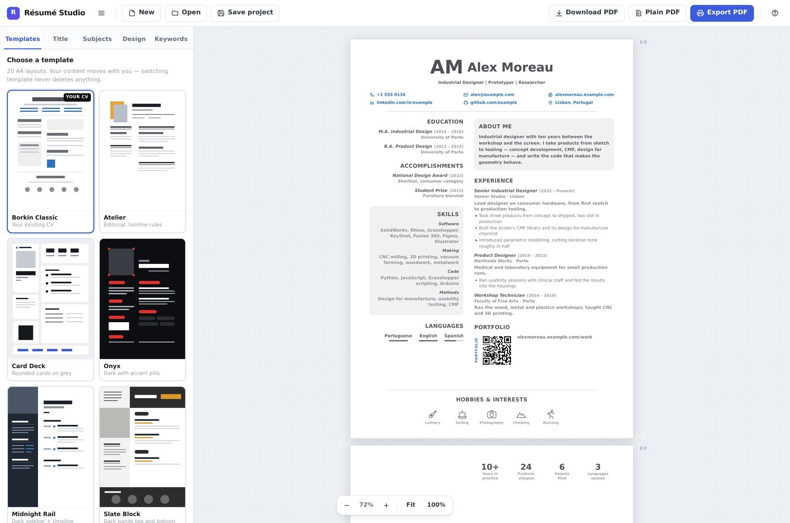
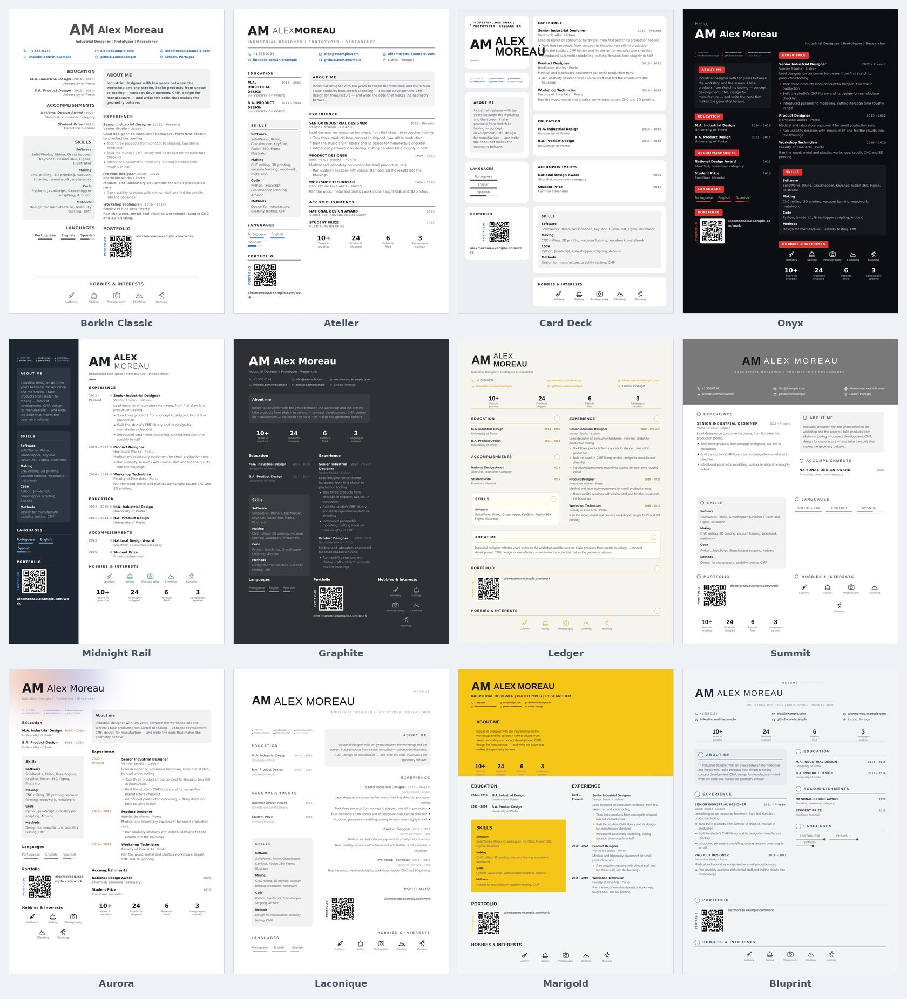
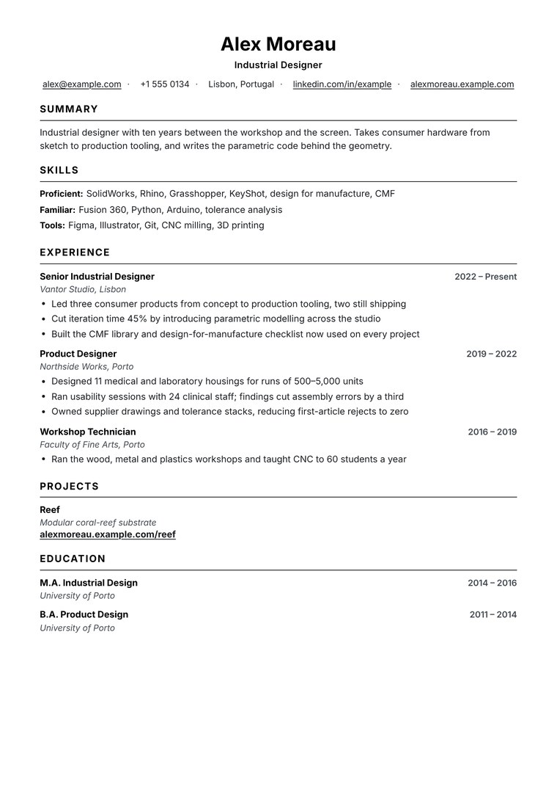
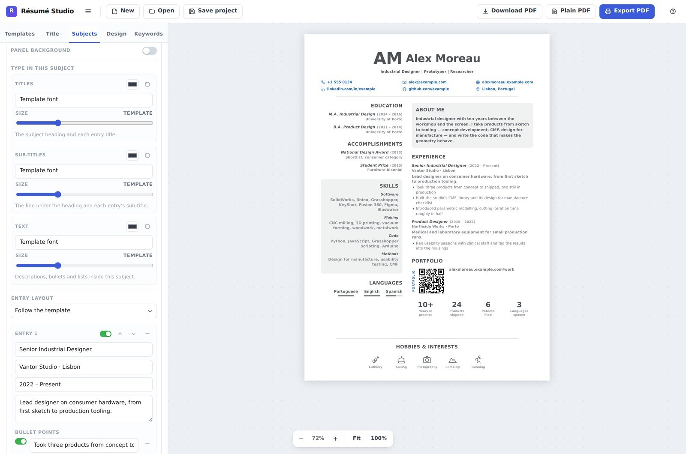
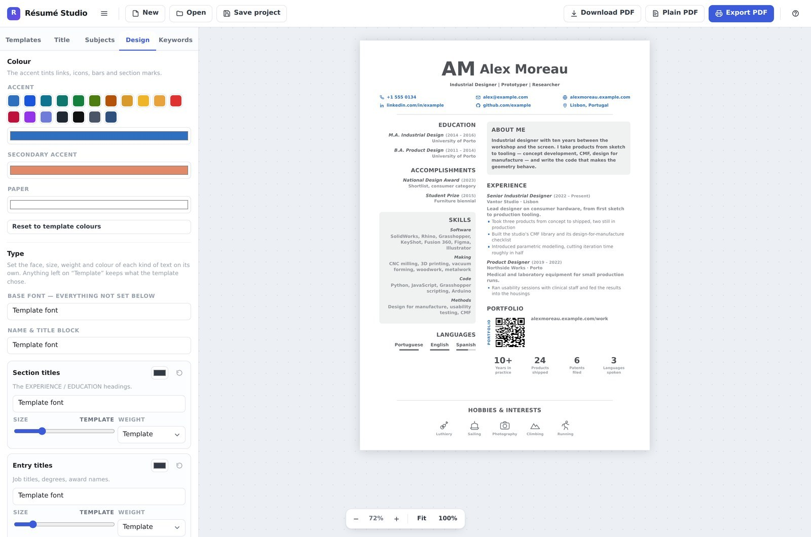
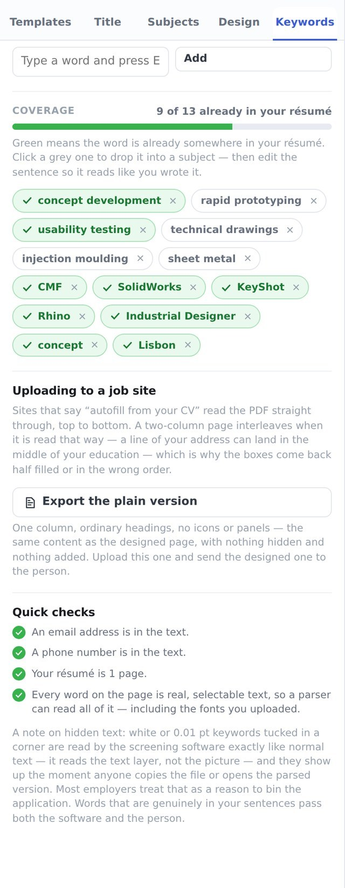
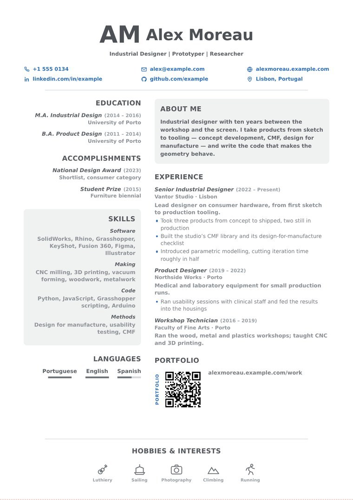
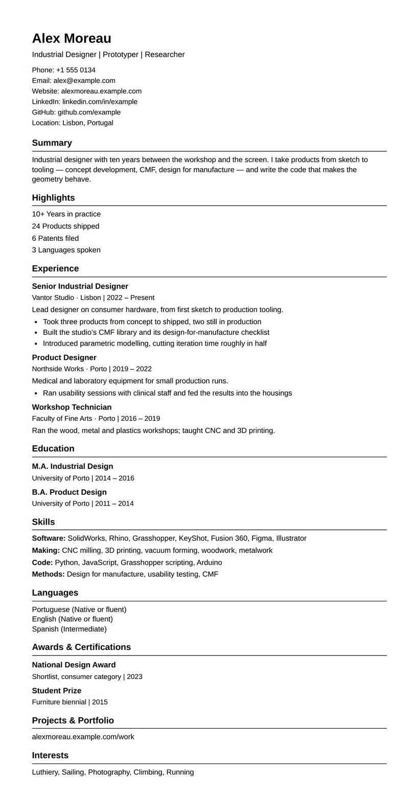

# Résumé Studio

Copyright © 2026 [Roy Borkin](https://royborkin.github.io) · All rights reserved ·
[Source-available licence](LICENSE)

A résumé builder that is one HTML file. Open it in a browser and you get twenty-one A4 templates, a live
editor, 69 embedded fonts, an offline QR generator and three ways out to PDF. No installer, no account,
no server, no build step — and nothing you type ever leaves your machine.



<sub>Every screenshot on this page uses a fictional person; `example.com` and `+1 555 01xx` are reserved for
documentation.</sub>

---

## Contents

- [Why](#why)
- [Quick start](#quick-start)
- [Hosting it on GitHub Pages](#hosting-it-on-github-pages)
- [The twenty-one templates](#the-twenty-one-templates)
- [Building a résumé](#building-a-résumé)
- [Fonts](#fonts)
- [The portfolio QR code](#the-portfolio-qr-code)
- [Keywords, and a word about hidden text](#keywords-and-a-word-about-hidden-text)
- [Getting it out: three exports](#getting-it-out-three-exports)
- [Saving and reopening](#saving-and-reopening)
- [Keyboard](#keyboard)
- [Privacy](#privacy)
- [Browser support](#browser-support)
- [How it is put together](#how-it-is-put-together)
- [What has been tested](#what-has-been-tested)
- [Licence and credits](#licence-and-credits)

---

## Why

Most résumé tools make you choose between a page that looks designed and a page that a machine can read.
This one does both, and keeps them separate rather than pretending one file can be both at once: a designed
A4 page for the person who reads it, and a plain one-column version for the site that parses it.

Everything runs in the browser from a single file. You can keep it on a USB stick, open it on a plane, and
it works exactly the same.

---

## Quick start

**Option 1 — just use it.** Download `index.html` from this repository and double-click it. That's the
whole program.

**Option 2 — the hosted copy.** If this repo has GitHub Pages switched on, the app is at
`https://<your-user>.github.io/<repo>/`. Opening that page downloads the file into your browser once; after
that it behaves like the local copy.

**Option 3 — clone it.**

```bash
git clone https://github.com/<your-user>/<repo>.git
cd <repo>
open index.html        # macOS   (xdg-open on Linux, start on Windows)
```

There is no `npm install` and no toolchain. The file has no dependencies at runtime.

---

## Hosting it on GitHub Pages

The app is a static file, so Pages needs nothing special.

1. Name the file **`index.html`** in the repository root. (If you are starting from `Resume Builder.html`,
   rename it — that is the only step people usually miss.)
2. Push it.
3. **Settings → Pages → Build and deployment → Source: Deploy from a branch**, branch `main`, folder `/ (root)`.
4. Wait for the green tick, then open `https://<your-user>.github.io/<repo>/`.

A suggested layout:

```
.
├── index.html          # the entire application (~2.5 MB)
├── screenshots/        # the images in this README
├── LICENSE
└── README.md
```

The file is around 2.5 MB because the fonts and icons are inside it. That is well under every GitHub limit,
and it means the hosted copy works offline once loaded.

If you keep your own saved projects next to it, add a `.gitignore` so they stay private:

```gitignore
*.resume.json
*.pdf
```

---

## The twenty-one templates

Content is kept separately from the layout, so switching template rearranges your résumé instead of asking
you to retype it. Twelve of the twenty-one, all showing the same content:



| Template | Look |
| --- | --- |
| Borkin Classic | Centred header, contact grid, two columns — the house style |
| Atelier | Editorial, hairline rules |
| Card Deck | Rounded cards on grey |
| Onyx | Dark with accent pills |
| Midnight Rail | Dark sidebar and timeline |
| Slate Block | Dark bands top and bottom |
| Amber Quote | Quote card, spaced name |
| Executive | Plain and parser-friendly, main column left |
| Aurora | Soft gradient, airy |
| Linen | Cream paper, serif, blue ink |
| Chevron | Angled accent, dotted ratings |
| Dual Script | Two columns, bilingual titles |
| Graphite | Charcoal, three-column grid |
| Summit | Full-bleed photo hero |
| Ledger | Cream, accent rings, dot ratings |
| Sandstone | Blush header, accent job titles |
| Nightshift | Near-black with an electric accent |
| Laconique | Minimal, right-aligned, airy |
| Marigold | Colour band, colour panels, chips |
| Bluprint | Centred masthead, circled marks |
| **Playbook** | One column, plain, built for screeners |



**Playbook** is the odd one out, and deliberately so. It is built to the rules in a résumé playbook rather than
to a visual reference: one column, black text, conventional headings (Summary, Skills, Experience, Projects,
Education), plain bullets, and none of the things screening software trips over — no tables, no icons, no skill
bars, no colour blocks, no photo by default. Its header is a name, a target job title and one line of contact
details. Where the other twenty are designed for the person reading them, this one is designed for the pass
before that. Run the same CV through a text extractor both ways and the difference is the whole point:

| | a two-column template | Playbook |
| --- | --- | --- |
| heading order as read | skills → summary → experience → education → projects | summary → skills → experience → projects → education |
| heading followed by its own first line | 2 of 5 | 5 of 5 |
| contact details | split across the columns | one line, unbroken |

Every template is A4, paginates on its own, and knows which of its four areas — header, side column, main
column, footer — each kind of subject belongs in.

---

## Building a résumé



**Subjects.** Contact details, about me, work experience, education, skills, languages,
achievements, portfolio, interests, what drives me, key numbers, and free text blocks. Drag to reorder.
The coloured chip moves a subject between the header, the side column, the main column and the footer.

**Show or hide anything, at any level.** Each subject has a switch, and so does every entry inside it —
every job, course, award, contact row, skill group, language, link and interest — right down to individual
bullet points. A switched-off item leaves the page and the PDF but stays in the project, still editable and
still movable. One file can hold three versions of the same job and show only the one that suits the
application.

**Per-subject design.** Text alignment (left, centred, right, justified); an optional panel behind the
subject with its own fill colour, opacity, text colour, corner radius, padding and border; and the option
to let that panel bleed to the edge of the paper. Titles, sub-titles and body text each take their own
face, size and colour — set globally in **Design**, overridden per subject where you want it.



**The title block.** Name, two sub-titles, a photo (circle, rounded or square, with border, grayscale and
offset controls) and a monogram or logo. Size, weight, tracking, spacing and placement are all adjustable,
and every control has a reset arrow back to whatever the template intended.

**Contact rows that never clip.** One to eight entries per row. Each takes only the width it needs and the
leftover space is shared out evenly; if a row would still be too wide, the whole block shrinks slightly
rather than cutting a word in half or dropping it to a second line. Every entry can carry a hyperlink that
stays live in the exported PDF.

**Right-to-left.** A single switch in **Design** flips the whole document for Hebrew or Arabic, including
alignment, bullet positions and the vertical QR label. Thirteen of the bundled fonts carry full Hebrew.

---

## Fonts

69 variable families are built into the file — sans, condensed, serif, mono, display, handwriting, and
thirteen with Hebrew. They work with no internet at all, and because each is a variable font, every weight
from Light to Black comes from one file.

You can also add your own: **Design → Your fonts → Add font files…** takes `.ttf`, `.otf`, `.woff` and
`.woff2`. The family name and weight are read out of the file itself, so dropping in several weights of one
family matches them up automatically. Uploaded fonts are stored inside the saved project, so the résumé
keeps its look on another machine.

---

## The portfolio QR code

Portfolio links can show a QR code, generated offline by an encoder built into the file — nothing is sent
to a service to draw it. The label sits under the code, vertically beside it, or not at all.

The code and its label are one clickable link in the PDF, so the same block works on screen and on paper.
You can set the colour of the code and of what sits behind it, or let the page show through. A line under
the pickers reports the contrast and warns you when a combination will not scan: phone cameras want dark
squares on a light background, and a light code on a dark panel fails however good it looks. It also warns
when a long link has packed the squares too small to print well.

---

## Keywords, and a word about hidden text



Applications are usually read by software before a person sees them. The **Keywords** tab helps with that
honestly: paste the job advert and it pulls out the words that carry meaning, or start from a suggested set
for your field and add your own. Green means the word is already somewhere in your résumé, grey means it is
not — click a grey one to drop it into a real subject, then edit the sentence so it reads like you wrote it.
There is a coverage bar and a few quick checks (email present, phone present, page count).

Nothing in this tab is printed, exported or written into the PDF.

**This tool deliberately does not do the "hidden keywords" trick** — white or 0.01 pt text tucked in a
corner. It does not work: screening software reads the text layer, so invisible text is extracted and
scored exactly like visible text, and it surfaces the moment anyone copies the file or opens the parsed
view. Most employers treat finding it as a reason to bin the application. Words that are genuinely in your
sentences pass both the software and the person.

---

## Getting it out: three exports

| Button | What you get | Use it for |
| --- | --- | --- |
| **Export PDF** | The designed page through the browser's own print engine. Real selectable text, embedded fonts, live hyperlinks. | The version you send or attach. The best one for anything that will be read or parsed. |
| **Plain PDF** | The same content as one ordinary column with plain headings, no icons or panels. | Uploading where a site offers to "autofill from your CV". |
| **Download PDF** | Saved immediately with no print dialog: an exact picture of the page with a layer of real text laid precisely over it, so it can be selected, copied, searched and read by screening software. Links stay clickable. | A quick share when you just want the file. |

The same résumé, both ways — the designed page on the left, the plain version on the right:

<table>
<tr>
<td width="50%" valign="top" align="center"><br><sub><b>Export PDF</b> — for the person reading it</sub></td>
<td width="50%" valign="top" align="center"><br><sub><b>Plain PDF</b> — for the site parsing it</sub></td>
</tr>
</table>

### Why the plain version exists

A designed résumé has two columns. A parser reads a PDF straight down the page in one pass, so those
columns interleave. Here is the real text an extractor pulls out of the designed page above, starting at
the first section heading:

```
EDUCATION
ABOUT ME                                      ← the other column cuts in
M.A. Industrial Design (2014 – 2016)
Industrial designer with ten years between the
workshop and the screen. I take products from sketch
to tooling — concept development, CMF, design for
manufacture — and write the code that makes the
geometry behave.
University of Porto                           ← the degree's institution, six lines later
B.A. Product Design (2011 – 2014)
University of Porto
```

The degree and the university it came from end up separated by an entire paragraph belonging to a
different section. That is why autofill comes back half empty or in the wrong boxes. The plain export puts
the same content — same entries, same wording, hidden items still hidden, nothing added — into one column
with the headings a parser expects. The same résumé, both ways:

| | designed page | plain version |
| --- | --- | --- |
| headings in reading order | education → summary → accomplishments → skills → experience | summary → experience → education → skills |
| line after each heading | belongs to that section once out of four times | correct every time |
| contact details | one block, then the columns begin to alternate | one block, one detail per line |

Upload the plain one; send the designed one to the person.

---

## Saving and reopening

**Save project** downloads a `.resume.json` file holding everything — your content, every design decision,
your photo and any fonts you uploaded. **Open** loads it back. Projects saved by older versions keep
working: missing fields are filled in with sensible defaults when the file loads.

Work in progress is also kept in the browser automatically, so reopening the page restores your last
session.

---

## Keyboard

| Shortcut | Does |
| --- | --- |
| `Ctrl` + `S` | Save project |
| `Ctrl` + `P` | Export PDF |
| `Ctrl` + `O` | Open a project |
| `Ctrl` + `0` | Zoom to 100% |

---

## Privacy

Everything happens in your browser. There is no server, no account, no analytics and no network request —
the fonts, the icons and the QR encoder are all inside the file. Your résumé, your photo and your saved
projects stay on your own disk. The one exception is **Download PDF**, which fetches one rendering
library (html2canvas) from a CDN the first time you use it — the PDF itself is written by the app, in your
browser. If you are offline it says so and points you at Export PDF.

---

## Browser support

Chrome, Edge, Firefox and Safari, current versions. Chrome and Edge give the best PDF export, mainly
because their print dialog has the "Save as PDF" destination and reliable background-graphics handling.
For an exact A4 page choose paper **A4**, margins **None**, and tick **Background graphics**.

---

## How it is put together

One HTML file, hand-written, no framework and no runtime dependencies. Inside it:

- a measurement-driven A4 pagination engine that pours content into each template's zones and splits long
  subjects entry by entry rather than dropping whole blocks to the next page;
- 20 template themes driven entirely by CSS custom properties, so a user override and a template default
  share one mechanism;
- a dependency-free QR encoder (byte mode, versions 1–14, all four error-correction levels, mask penalty
  selection);
- 94 inline SVG icons;
- 69 variable fonts, subset and instanced, embedded as base64 WOFF2;
- an OpenType name-table parser, so an uploaded font reports its own family and weight.

---

## What has been tested

The behaviour in this README is checked by fourteen Playwright suites — 308 assertions covering layout
across all 21 templates, contact fitting, pagination, fonts, per-element visibility, the keyword tool, the
QR code and all three export paths.

Some of it is verified outside the browser as well: exported PDFs are rendered at 300 dpi and the QR codes
decoded with OpenCV, link annotations are read back out of the PDF and compared with where the app said it
would put them (they agree to within 0.4 mm), and the plain export is run through a text extractor to
confirm the sections come out in the right order.

---

## Licence and credits

**Copyright © 2026 [Roy Borkin](https://royborkin.github.io). All rights reserved.**

This project is **source-available, not open source**. You are welcome to read the code and to run it for
your own personal use, including making your own résumé with it and applying for paid work with the result.
Redistributing it, publishing a modified version or a fork, or selling it or including it in anything sold,
needs written permission first. The full terms are in [LICENSE](LICENSE).

**Anything you make with it is yours.** The licence covers the software only. Your résumé, your text, your
photo, your saved `.resume.json` files and every PDF you export belong entirely to you — the licence gives
the copyright holder no claim over them whatsoever, and the app sends nothing anywhere to begin with.

The bundled typefaces come from the [Google Fonts](https://fonts.google.com) collection under the
[SIL Open Font License 1.1](https://openfontlicense.org), except Roboto, which is Apache 2.0. Those licences
belong to their authors, continue to govern those fonts, and are neither restricted nor altered by the
terms above.

**Download PDF** loads [html2canvas](https://html2canvas.hertzen.com) (MIT licence, © Niklas von Hertzen)
from cdnjs when you first press it, to draw the page; it is not part of this repository.

---

<sub>Résumé Studio · Copyright © 2026 Roy Borkin · https://royborkin.github.io</sub>
